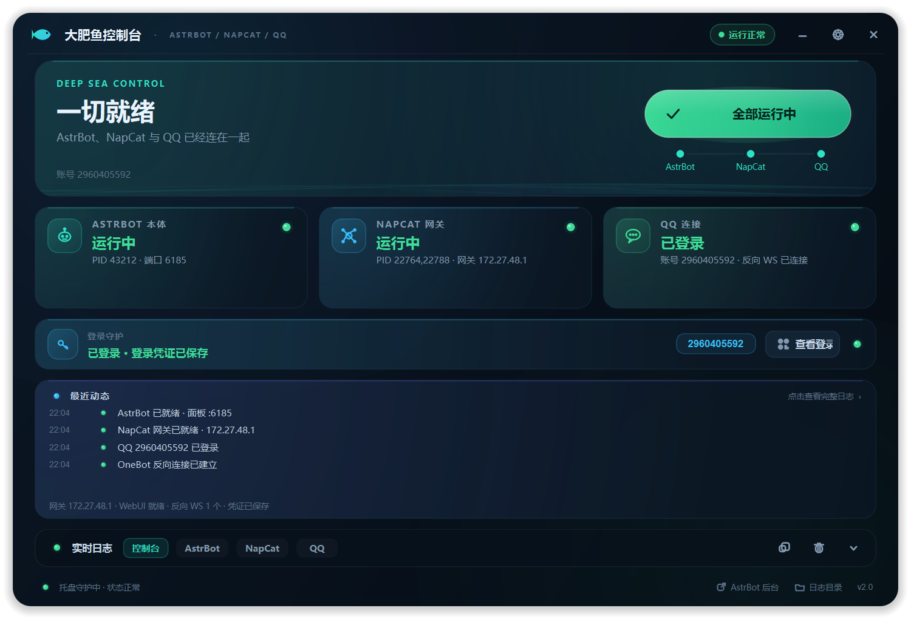
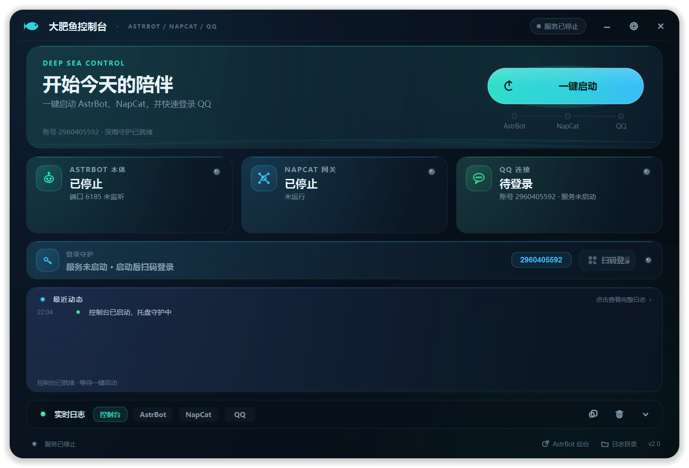
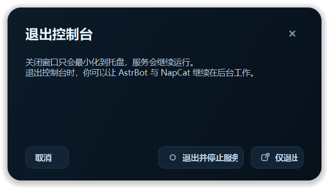
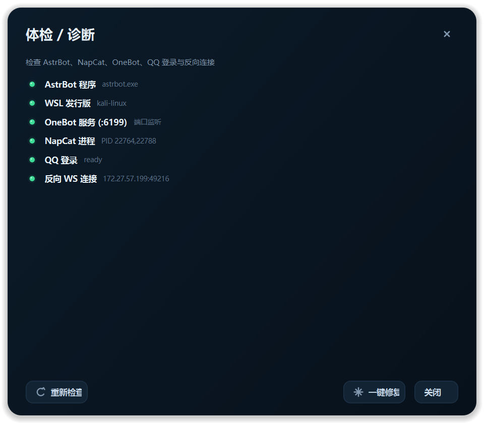
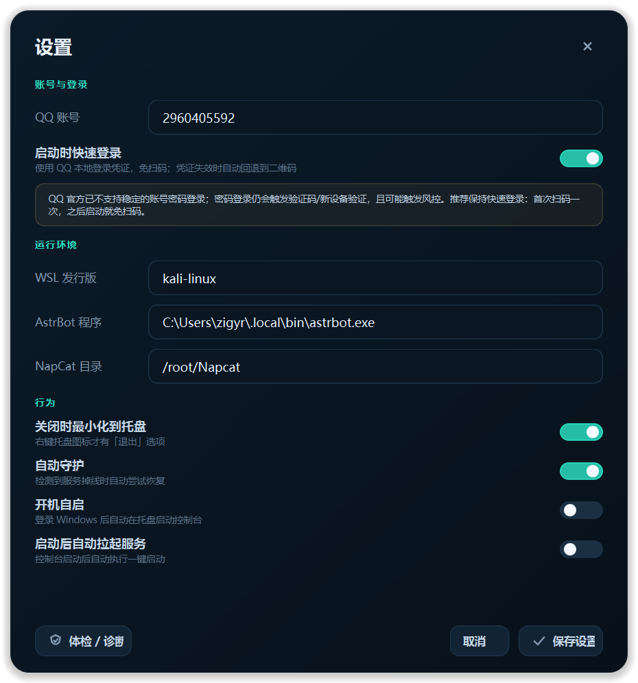

# 🐟 大肥鱼控制台 v2

一个面向 **AstrBot（Windows）+ NapCat（WSL Kali）+ QQ** 的本地控制台：
无边框深海主题、动态状态、托盘驻留、一键启动、自动校准 OneBot 连接、
快速登录、二维码自动换新、体检与自动修复。

> 双击根目录的 **`大肥鱼控制台.vbs`** 即可启动。
> 使用 `pythonw.exe` 启动，不会再出现 `astrobot.exe` 的黑色控制台窗口。
>
> 启动器已做可移植处理：以 `vbs` 自身位置定位项目根目录，并依次从
> `DAFEIYU_PYTHONW` 环境变量、项目内 `python\`、常见 Python 安装目录、`PATH`
> 中寻找 `pythonw.exe`；找不到时会弹出明确提示。



---

## 1. 界面与交互

- **一键启动**：只保留一个主按钮。自动完成：
  1. 检查 WSL / AstrBot；
  2. 校准 AstrBot 的 `aiocqhttp` 平台（0.0.0.0:6199）；
  3. 读取 WSL 网关 IP，校准 NapCat 的 `onebot11*.json`（URL + token）；
  4. 启动 NapCat（Xvfb + screen，全程无窗口）；
  5. 通过 NapCat WebUI 查询登录态，优先快速登录；
  6. 校验 6199 反向 WS，必要时自动重启 NapCat 重载配置；
  7. 没有登录凭证时自动取一张**新鲜二维码**。
- **状态不靠猜**：
  - AstrBot：端口 6185 / PID；
  - NapCat：WSL 进程 + WebUI；
  - QQ：WebUI 登录态 + 6199 反向 WS 连接。
  - 所以能区分「QQ 没登录」「QQ 登录了但 AstrBot 没连上」「WebUI 没起来」，
    不会再笼统显示“QQ 未连接 NapCat”。
- **最近动态**：显示启动、登录、连接、修复等关键事件；点击卡片展开完整日志。
- **实时日志**：默认只占 42px，点右侧箭头才展开到 200px；
  只有 `控制台 / AstrBot / NapCat / QQ` 四个来源，不再让黑色日志占满屏幕。
- **关闭 = 最小化到托盘**：点右上角 × 或系统关闭，窗口收进托盘，服务继续运行。
  右键托盘小鱼图标才会看到 **「退出控制台」**。
- **单实例**：重复双击启动器只会把已打开的控制台叫到前台（本机 TCP 6197 通讯）。



---

## 2. 扫码登录与“免扫码”（重点）

### 为什么不直接用账号密码？

QQ NT 官方客户端已经不再提供稳定的“账号 + 密码”登录通道。NapCat 的密码登录接口
仍然会触发 **验证码 / 新设备验证 / 风控**，而且把密码交给第三方控制台保存并不安全。
所以本控制台**不保存密码**，也不推荐密码登录。

### 推荐方案：快速登录（本地凭证）

1. 第一次使用：点「扫码登录」，用手机 QQ 扫一次；
2. 登录成功后，NapCat / QQ 会把本地登录凭证保存在 QQ 数据目录；
3. 之后启动 NapCat 时，控制台会通过 WebUI 的 `GetQuickLoginList` / `SetQuickLogin`
   自动快速登录，通常**不需要再扫码**；
4. 如果凭证过期、账号被踢下线、或 QQ 数据目录被清理，控制台会自动退回二维码，
   并显示新的二维码（不是缓存里的旧图）。

> 设置里的「启动时快速登录」默认开启。
> 想彻底重置登录，点设置 → 关闭快速登录，或在 NapCat 里退出登录后重新扫码。

### 如果仍然每次都要扫码

按顺序检查：

- 是否换了 WSL 发行版 / 清空了 `/root` 下 NapCat 或 QQ 的数据目录；
- 是否频繁使用 NapCat 的「重置设备 ID / 修改 MAC」——这会触发新设备验证；
- QQ 账号是否在手机上被其他设备挤下线；
- NapCat 是否每次都以同一个用户、同一个数据目录运行；
- 诊断面板里的「QQ 登录」和「反向 WS 连接」是否正常。

本控制台没有“绕过扫码”的魔法：**首次凭证 + 本地持久化 + 快速登录** 才是稳定方案。


---

## 3. 关闭、托盘与退出

| 操作 | 行为 |
| --- | --- |
| 右上角 × / Alt+F4 | 隐藏到系统托盘，服务继续运行 |
| 最小化按钮 | 最小化到任务栏（不隐藏） |
| 双击托盘图标 | 重新显示控制台 |
| 右键托盘图标 | 显示控制台 / 一键启动 / 扫码登录 / 打开后台 / 停止全部服务 / **退出控制台** |
| 退出控制台 | 可选择「仅退出」或「退出并停止服务」 |



---

## 4. 体检与自动修复

- 设置 → 「体检 / 诊断」会检查：AstrBot 程序、WSL 发行版、OneBot 6199、
  NapCat 进程、WebUI、QQ 登录、反向 WS、OneBot 配置是否匹配、WSL→Windows 6199 是否可达。
- 服务未启动时，相关项目会显示为 **[--] 预期跳过**（蓝色），不是故障；
  先点「一键启动」，等服务运行后再体检。只有运行中仍失败的项目才显示红色 **[!!]**。
- 「复制结果」可把检查项与失败建议直接复制出来，方便反馈。
- 如果检测到「WSL → Windows 6199」不可达，会出现「放行 6199」按钮：
  通过 UAC 添加一条命名入站规则（`Dafeiyu OneBot 6199`），只放行 TCP 6199。
  不想改系统时，也可以按第 6.5 节手动执行 `netsh`。
- 「一键修复」会重新校准配置并重启缺失/异常的服务。
- 开启「自动守护」后，若 AstrBot/NapCat 掉线，或 QQ 登录了但反向 WS 断开，
  控制台会限频自动尝试恢复（不会无限重启）。



---

## 5. 设置

- **QQ 账号**：默认 `2960405592`；
- **启动时快速登录**：见上一节；
- **WSL 发行版**：默认 `kali-linux`；
- **AstrBot 程序**：默认 `C:\Users\zigyr\.local\bin\astrbot.exe`；
- **NapCat 目录**：默认 `/root/Napcat`；
- **关闭时最小化到托盘**；
- **自动守护**；
- **开机自启**：写入 `HKCU\Software\Microsoft\Windows\CurrentVersion\Run`；
- **启动后自动拉起服务**：适合“开机后自动挂机器人”。

> 配置保存在 `console/settings.json`，其中含账号与 OneBot token，已在 Git 中忽略。
> 换机或重装时，参考 `console/settings.example.json` 重建该文件（token 留空，
> 首次「一键启动」会从 AstrBot 配置自动同步）。



---

## 6. 常见问题

### 6.1 点一键启动后，astrobot.exe 黑框还在？

本版本用 `CREATE_NO_WINDOW + SW_HIDE` 启动 AstrBot，控制台本身用 `pythonw.exe` 启动。
如果你还看到黑框：

- 确认双击的是 **`大肥鱼控制台.vbs`**，不是 `app.py` / `python.exe`；
- 旧的控制台（`archive\legacy\web-console\server.py` 的 Web 版或旧 tkinter 版）可能还在运行，先关掉；
- 检查是否有旧的 `astrobot.exe` 进程被其他脚本拉起。

### 6.2 QQ 显示未连接？

先看控制台的三张卡：

- **AstrBot 运行中、NapCat 运行中、QQ 已登录但「通道未连接」**：
  通常是 WSL 网关 IP 变了、NapCat 的 `onebot11*.json` 没更新、token 不一致，
  或 Windows 防火墙拦截了 WSL → 6199。点「一键修复」；仍不行就看诊断里的
  「WSL → Windows 6199」。
- **QQ 待登录**：点「扫码登录」。
- **NapCat WebUI 未就绪**：NapCat 可能还在启动，或 WebUI 被禁用/端口被占用。

### 6.2.1 一键启动卡在 NapCat 阶段？

新版启动器会把自身环境和错误写入 `/root/napcat-run.log`，包括：

- QQ 路径与权限（`ls -l`）；
- `xvfb-run` / `Xvfb` / `screen` 是否存在；
- `screen -ls` 状态；
- 失败时的 `xvfb` 日志尾部。

启动脚本固定写在 `/root/napcat-start.sh`，可直接手工执行排查：

```bash
bash /root/napcat-start.sh
tail -n 80 /root/napcat-run.log
```

控制台失败后会自动展开日志；也可以点「控制台」或「NapCat」标签查看完整内容。
诊断面板会列出「NapCat QQ 可执行」「NapCat 依赖 · xvfb-run / Xvfb / screen」。
如果缺失，在 WSL 里安装 `xvfb`、`screen`；如果 QQ 没有执行权限，执行 `chmod +x`。

### 6.3 二维码显示已失效？

本版本优先通过 NapCat WebUI 的 `RefreshQRcode` 取新二维码，并在本地重新生成，
不再直接显示 `qrcode.png` 缓存。二维码弹窗还有倒计时，过期会自动换新。
只有在 WebUI 不可用时才回退到缓存图片，并明确提示“已过期”。

### 6.4 启动时提示 WSL 无法访问？

- `wsl -l -v` 确认 `kali-linux` 存在；
- 在设置里改成你的发行版名称；
- 确认 WSL 服务已启动（`WSLService`）。

### 6.5 Windows 防火墙拦截 6199？

以管理员身份执行一次：

```text
netsh advfirewall firewall add rule name="Dafeiyu OneBot 6199" dir=in action=allow protocol=TCP localport=6199 profile=any
```

---

## 7. 文件说明

```text
F:\dafeiyu\
├─ 大肥鱼控制台.vbs          # 双击启动（pythonw，无黑框；自动查找 pythonw）
├─ 使用说明.md               # 本文件
├─ 任务交接文档.md           # 交接说明 + 功能增删改记录
├─ docs\
│  ├─ 变更管理.md            # PCR 流程、提交规范、PCR 索引
│  └─ pcr\
│     ├─ _模板.md            # PCR 模板
│     └─ PCR-0001…0003.md    # 每个变更一份
├─ console\
│  ├─ app.py                 # 入口：单实例、托盘、参数
│  ├─ ui.py                  # 主窗口、二维码/设置/诊断/退出弹窗
│  ├─ widgets.py             # 自绘卡片、按钮、状态点、日志抽屉
│  ├─ theme.py               # 深海配色 / QSS
│  ├─ core.py                # AstrBot / WSL / NapCat / WebUI 后端
│  ├─ service.py             # 线程池 + Qt 信号
│  ├─ settings.py            # 配置 / 开机自启
│  ├─ settings.example.json  # 配置样例（不含 token）
│  ├─ demo.py                # 演示数据（--demo）
│  ├─ vendor\qrcode\         # 离线二维码生成（BSD）
│  └─ preview\               # 界面预览图
├─ tools\setup\              # 一次性运维脚本（凭据走环境变量）
├─ archive\legacy\           # 旧 Web 控制台（不参与运行）
├─ astrbot\                  # AstrBot 工作目录（运行时数据不入库）
├─ napcat\                   # Windows NapCat（旧方案，保留）
├─ logs\                     # 控制台日志 / AstrBot 日志 / 诊断截图
└─ QQ\                       # 旧 Windows QQ 副本（保留）
```

> `QQ\`、`napcat\`、`_download\`、`logs\`、`astrbot\` 与 `console/settings.json`
> 都不纳入 Git，仅保留在本机；仓库只跟踪源码、文档与预览图。

---

## 8. 调试

```powershell
# 演示模式（不碰 WSL）
F:\Compilers\python3\python.exe F:\dafeiyu\console\app.py --demo

# 无界面诊断：输出真实 WSL/NapCat/QQ 状态，并保存到 logs\diagnose-*.txt
# 服务未启动时相关项显示 [--] 预期跳过；启动后再跑一次才是完整验收
F:\Compilers\python3\python.exe F:\dafeiyu\console\app.py --diagnose

# 离屏截图
F:\Compilers\python3\python.exe F:\dafeiyu\console\app.py --screenshot F:\dafeiyu\logs\ui.png --state running

# 自检（不启动服务）
F:\Compilers\python3\python.exe F:\dafeiyu\console\selftest.py
```

控制台异常会写入 `logs\console-error.log`；关键事件写入 `logs\console-events.log`。

---

## 9. 变更管理与 Git

- 仓库：<https://github.com/zigyr/Dafeiyu>（`main` 分支）。
- 每次需求先按 `docs/变更管理.md` 的流程生成 PCR，确认后再改代码；
  PCR 存放在 `docs/pcr/`，编号从 `PCR-0001` 起递增。
- 每次功能增删改都要登记到 `任务交接文档.md`，包含变更点、影响、验证与回滚。
- 提交信息遵循 Conventional Commits，并引用 PCR 编号（如 `Refs: PCR-0001`）。

```powershell
git status
git log --oneline --decorate
git push origin main
```
